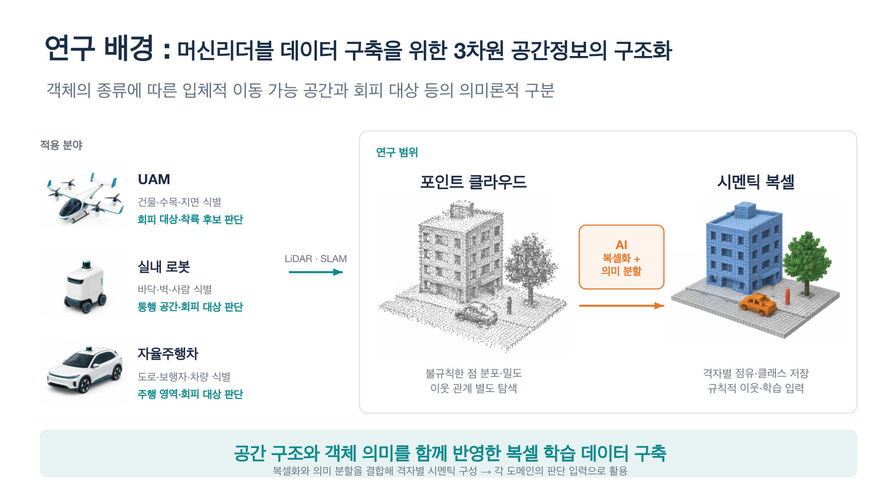
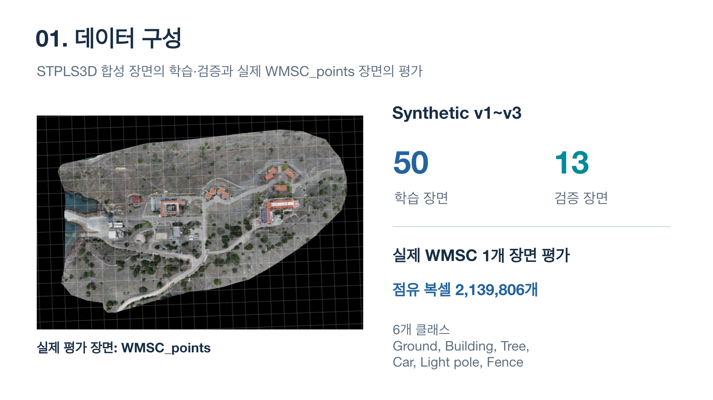
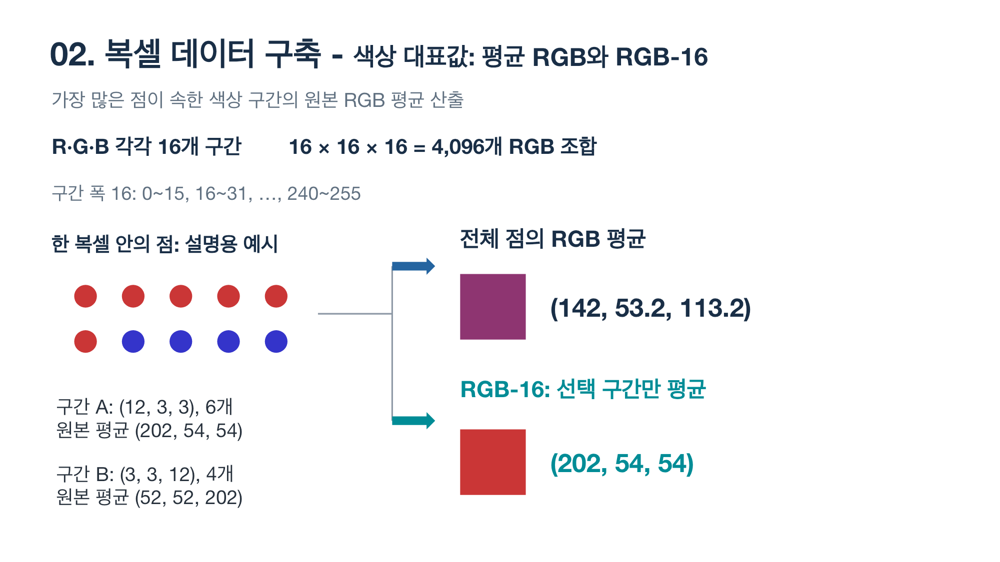
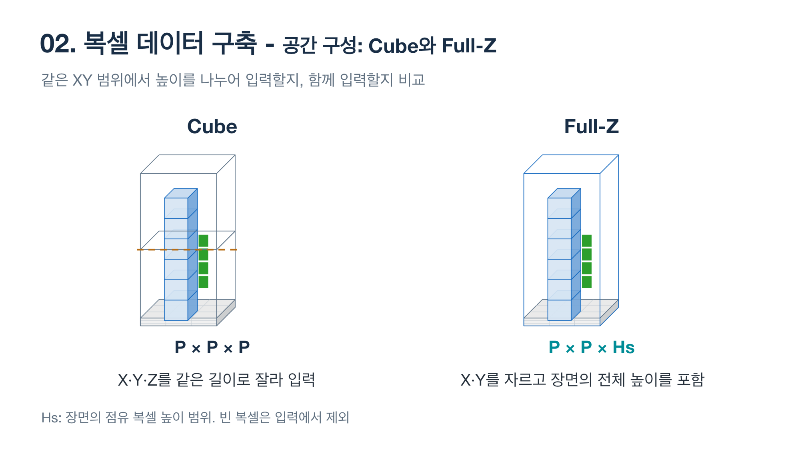
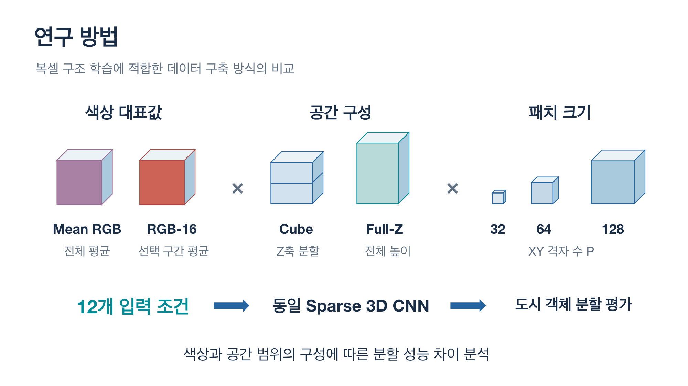
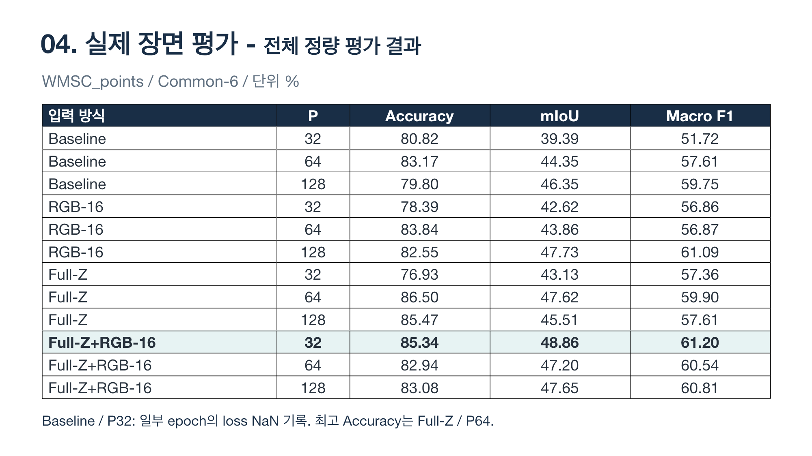
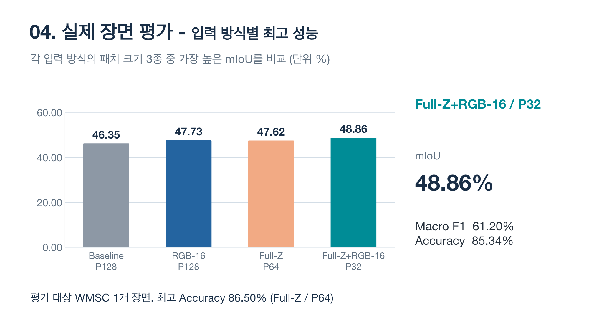
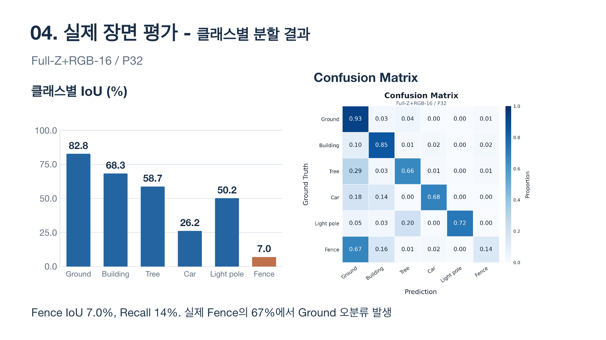
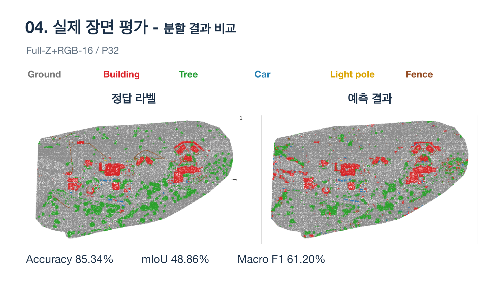
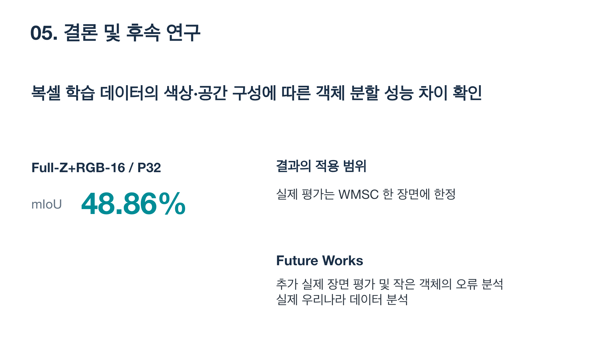

# 3D CNN 기반 도심 3차원 데이터 의미론적 분할을 위한 복셀라이제이션 기법별 성능 비교

## Project Overview

도시 3차원 Point Cloud를 voxel grid로 변환한 뒤, voxel 내부의 **color representation**과 입력 공간의 **spatial composition**이 Sparse 3D CNN semantic segmentation 성능에 미치는 영향을 비교한 연구입니다.

동일한 voxel resolution과 network를 유지하면서 색상 표현 2종, 공간 구성 2종, patch size 3종을 조합한 총 12개 조건을 실험했습니다.

| Item | Details |
|---|---|
| Conference | The 7th Korea Artificial Intelligence Conference · KOREA AI 2026 |
| Date | 2026-09-29 |
| Role | 공동 제1저자 (Co-first author) |
| Authors | 김재홍, 서재석, 박기욱, 이유진, 김광수, 이기훈 |
| Affiliation | Dongguk University, Konyang University, University of Ulsan, ETRI |
| Task | 6-class voxel-wise semantic segmentation |

## Background & Motivation

Point Cloud는 실제 공간의 형상을 정밀하게 표현하지만 점 분포와 밀도가 불규칙하고, 이웃 관계를 별도로 탐색해야 합니다. 이를 일정한 3D grid인 voxel로 변환하면 공간적 이웃 관계와 semantic label을 구조화해 자율주행, UAM, 실내 로봇 및 Digital Twin의 판단 입력으로 활용할 수 있습니다.

## Objectives

1. Point Cloud를 semantic voxel map으로 변환합니다.
2. Voxel color representation과 vertical spatial context 구성에 따른 성능 차이를 분석합니다.
3. Synthetic scene에서 학습한 모델을 실제 WMSC scene에서 평가합니다.
4. 전체 지표뿐 아니라 class-wise IoU와 confusion matrix를 통해 오류 특성을 확인합니다.

## Dataset

| Split | Source | Scale |
|---|---|---:|
| Train | STPLS3D Synthetic v1–v3 | 50 scenes |
| Validation | STPLS3D Synthetic v1–v3 | 13 scenes |
| Evaluation | STPLS3D RealWorldData `WMSC_points` | 1 scene, 2,139,806 occupied voxels |

원본 class는 voxel 내부에서 majority voting한 후 다음 6개 Common Class로 통합했습니다.

- Ground
- Building
- Tree
- Car
- Light pole
- Fence

## Voxelization Methods

### Common configuration

- Voxel size: `0.3 × 0.3 × 0.3 m`
- Storage: occupied voxels only
- Input feature: occupancy, RGB, normalized XYZ의 7 channels
- Voxel label: 원본 class majority voting 후 Common-6 mapping
- 동률 발생 시: 동률 class의 point 중 voxel 중심에 가장 가까운 point의 label 선택

### Color representation

- **Mean RGB:** voxel 내부 모든 point의 RGB 평균
- **RGB-16:** RGB channel을 각각 16개 구간으로 나눈 뒤, 가장 빈도가 높은 RGB 조합 구간에 속한 원본 RGB 값만 평균

### Spatial composition

- **Cube:** X, Y, Z를 동일한 길이의 `P × P × P` patch로 분할
- **Full-Z:** X와 Y만 `P × P`로 나누고 해당 scene의 전체 occupied height를 하나의 입력에 포함

## Experimental Setup

| Category | Setting |
|---|---|
| Input variants | Baseline, RGB-16, Full-Z, Full-Z+RGB-16 |
| Patch size | 32, 64, 128 |
| Model | Sparse 3D CNN encoder–decoder |
| Parameters | 4,496,467 |
| Encoder channels | 16, 32, 64, 128 |
| Context module | ASPP dilation 1/2/4, patch global context |
| GPU | NVIDIA RTX 5090 × 1 |
| Framework | PyTorch, native sparse processing |
| Batch / Max epochs | 24 / 35 |
| Optimizer | AdamW |
| Initial learning rate | 0.002 |
| Weight decay | 0.0001 |
| Scheduler | CosineAnnealingLR |
| Precision | FP16 AMP, sparse accumulation FP32 |
| Checkpoint | Highest validation mIoU |

Main loss는 `0.50 × Weighted CE + 0.30 × Lovasz-Softmax + 0.20 × Dice`로 구성했으며, auxiliary semantic head와 boundary head loss를 함께 사용했습니다.

## Results

### Quantitative comparison

WMSC_points 실제 장면에서 평가한 결과입니다. 단위는 `%`입니다.

| Method | Patch | Accuracy | mIoU | Macro F1 |
|---|---:|---:|---:|---:|
| Baseline | 32 | 80.82 | 39.39 | 51.72 |
| Baseline | 64 | 83.17 | 44.35 | 57.61 |
| Baseline | 128 | 79.80 | 46.35 | 59.75 |
| RGB-16 | 32 | 78.39 | 42.62 | 56.86 |
| RGB-16 | 64 | 83.84 | 43.86 | 56.87 |
| RGB-16 | 128 | 82.55 | 47.73 | 61.09 |
| Full-Z | 32 | 76.93 | 43.13 | 57.36 |
| **Full-Z** | **64** | **86.50** | 47.62 | 59.90 |
| Full-Z | 128 | 85.47 | 45.51 | 57.61 |
| **Full-Z+RGB-16** | **32** | 85.34 | **48.86** | **61.20** |
| Full-Z+RGB-16 | 64 | 82.94 | 47.20 | 60.54 |
| Full-Z+RGB-16 | 128 | 83.08 | 47.65 | 60.81 |

`Full-Z+RGB-16 / P32`가 mIoU `48.86%`, Macro F1 `61.20%`로 두 지표에서 가장 높은 결과를 기록했습니다. Accuracy 최고값은 `Full-Z / P64`의 `86.50%`입니다. 따라서 특정 입력 방식이 모든 지표에서 일관되게 최고라고 해석하지 않고, metric과 patch size의 상호작용을 함께 고려했습니다.

### Class-wise analysis

`Full-Z+RGB-16 / P32`의 class-wise IoU는 다음과 같습니다.

| Class | IoU (%) |
|---|---:|
| Ground | 82.8 |
| Building | 68.3 |
| Tree | 58.7 |
| Car | 26.2 |
| Light pole | 50.2 |
| Fence | 7.0 |

Fence recall은 14%였으며, 실제 Fence voxel의 67%가 Ground로 분류되었습니다. Ground와 Building 같은 대형 객체에 비해 Car와 Fence 같은 소형·희소 객체의 분할이 어려웠습니다.

### Qualitative comparison

## Limitations

- 실제 평가는 WMSC 1개 scene에 한정됩니다.
- 각 조건의 수치는 반복 실험 평균이 아닌 관측 결과입니다.
- `Baseline / P32`에서는 일부 epoch의 loss가 NaN으로 기록되어 재검증이 필요합니다.
- 성능 차이를 통계적 유의성으로 해석하지 않았습니다.
- 실제 국내 Point Cloud와 소형 객체에 대한 추가 분석이 필요합니다.

## Materials

- [발표자료 PPTX](./materials/KOREA-AI-2026-presentation.pptx)
- [발표자료 PDF 미리보기](./materials/KOREA-AI-2026-presentation.pdf)
- [논문 PDF](./materials/KOREA-AI-2026-paper.pdf)
