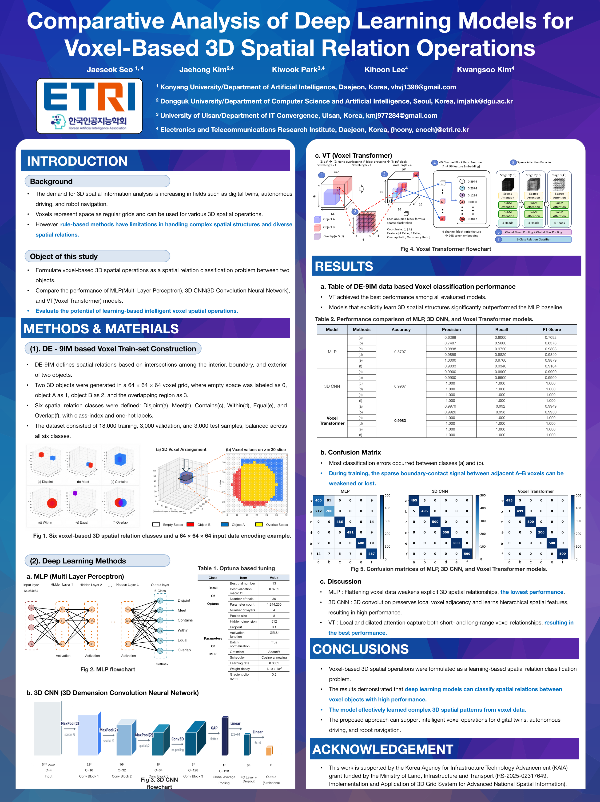

# Comparative Analysis of Deep Learning Models for Voxel-Based 3D Spatial Relation Operations

## Project Overview

두 3D voxel object 사이의 공간 관계를 rule-based operation이 아닌 **6-class learning problem**으로 정의하고, MLP, 3D CNN, Voxel Transformer의 분류 성능과 공간 구조 학습 능력을 비교한 연구입니다.

| Item | Details |
|---|---|
| Conference | KAIA 2026 · 한국인공지능학회 하계학술대회 |
| Date | 2026-08-06 |
| Role | 제1저자 (First author) |
| Authors | Jaeseok Seo, Jaehong Kim, Kiwook Park, Kihoon Lee, Kwangsoo Kim |
| Affiliation | Konyang University, Dongguk University, University of Ulsan, ETRI |
| Official record | [ETRI Knowledge Sharing Platform](https://ksp.etri.re.kr/ksp/article/read?id=73035) |

## Poster Overview

아래에서는 포스터를 연구 흐름에 따라 구역별로 나누어 설명합니다.

## 1. Introduction

Voxel은 3차원 공간을 규칙적인 grid로 표현하므로 occupancy, semantic information, height, risk 등의 정보를 cell 단위로 저장할 수 있습니다. 하지만 해상도가 높아질수록 데이터 크기가 급격히 증가하며, object boundary, interior/exterior, adjacency, connectivity 같은 관계를 고정된 수식과 규칙만으로 유연하게 처리하기 어렵습니다.

이 연구의 목적은 다음과 같습니다.

1. 두 voxel object 사이의 spatial relation을 classification problem으로 정의합니다.
2. Flattened feature를 사용하는 MLP, local structure를 학습하는 3D CNN, sparse token 관계를 학습하는 Voxel Transformer를 비교합니다.
3. Learning-based intelligent voxel operation의 가능성을 평가합니다.

## 2. Dataset Construction

DE-9IM의 공간 관계 개념을 바탕으로 두 3D object를 `64 × 64 × 64` voxel grid에 생성했습니다.

| Voxel value | Meaning |
|---:|---|
| 0 | Empty space |
| 1 | Object A |
| 2 | Object B |
| 3 | Overlapping region of A and B |

공간 관계는 다음 6개 class로 구성했습니다.

- Disjoint
- Meet
- Contains
- Within
- Equal
- Overlap

| Split | Samples |
|---|---:|
| Train | 18,000 |
| Validation | 3,000 |
| Test | 3,000 |

모든 class는 균형 있게 생성했으며, label은 class index와 one-hot encoding으로 저장했습니다.

## 3. MLP and 3D CNN

### MLP baseline

- Adaptive Average Pooling으로 voxel feature를 `8 × 8 × 8`로 축소
- Flatten 후 fully connected layers에 입력
- 4 hidden layers, hidden dimension 512
- GELU, Batch Normalization, Dropout 0.1
- Optuna 30 trials 수행
- Best trial: 13
- Best validation Macro F1: 0.8789
- Parameters: 1,844,230

MLP는 입력을 1차원 vector로 flatten하므로 voxel 간 local adjacency를 명시적으로 보존하기 어렵습니다.

### 3D CNN

- Four 3D convolution layers
- Kernel size `3 × 3 × 3`
- ReLU와 3D Max Pooling
- Adaptive 3D Global Average Pooling
- Cosine annealing learning-rate scheduler

3D convolution을 voxel space에 직접 적용하여 adjacency, boundary structure 및 connectivity 같은 local geometric pattern을 학습합니다.

## 4. Voxel Transformer

- `64³` voxel grid를 `4 × 4 × 4` blocks로 분할
- Non-empty block을 sparse token으로 변환
- Token feature: A ratio, B ratio, overlap ratio, occupancy ratio
- `16 × 16 × 16` sparse block grid
- Hidden dimension 96, attention heads 4
- Stage strides `[1, 2, 2]`
- Local and dilated attention with Fast Voxel Query
- Global mean/max pooling 후 6-class classification

Voxel Transformer는 sparse voxel token 간의 단거리·장거리 관계를 attention으로 모델링합니다.

## 5. Results and Discussion

논문 본문의 전체 test-set 결과는 다음과 같습니다.

| Model | Accuracy | F1-score |
|---|---:|---:|
| MLP | 0.8706 | 0.8696 |
| 3D CNN | 0.9967 | 0.9900 |
| **Voxel Transformer** | **0.9980** | **0.9979** |

MLP는 특히 `Meet` sample을 `Disjoint`로 분류하는 오류가 많았습니다. 두 class 모두 overlap ratio가 0이지만, Meet은 두 객체의 boundary가 접한다는 차이가 있습니다. Flattening된 representation에서는 이 local contact structure가 약화될 수 있습니다.

반면 3D CNN과 Voxel Transformer는 3D spatial structure를 보존하여 유사한 관계를 더 정확하게 구분했습니다. 실험에서는 Voxel Transformer가 가장 높은 전체 성능을 기록했습니다.

### Artifact-level metric note

발표 포스터와 논문 표 사이에 다음과 같은 소수점 차이가 확인됩니다.

| Model | Poster Accuracy | Paper Accuracy |
|---|---:|---:|
| MLP | 0.8707 | 0.8706 |
| Voxel Transformer | 0.9983 | 0.9980 |

위 결과표는 최종 논문 PDF의 수치를 기준으로 작성했으며, 포스터에 기재된 수치는 수정하지 않고 원본 자료에 그대로 보존했습니다.

## 6. Conclusion

- Voxel-based 3D spatial operation을 learning-based classification problem으로 구성할 수 있음을 확인했습니다.
- 3D spatial structure를 명시적으로 보존하는 모델이 flattened MLP baseline보다 높은 성능을 보였습니다.
- 제안한 접근은 Digital Twin, autonomous driving, robot navigation 및 3D spatial information analysis에 활용 가능성이 있습니다.
- 후속 연구에서는 distance-aware, topology-aware reasoning과 graph-based model을 검토할 수 있습니다.

## Materials

- [포스터 원본 PPTX](./materials/KAIA-2026-poster.pptx)
- [완성 포스터 1면 PDF](./materials/KAIA-2026-poster.pdf)
- [논문 PDF](./materials/KAIA-2026-paper.pdf)

